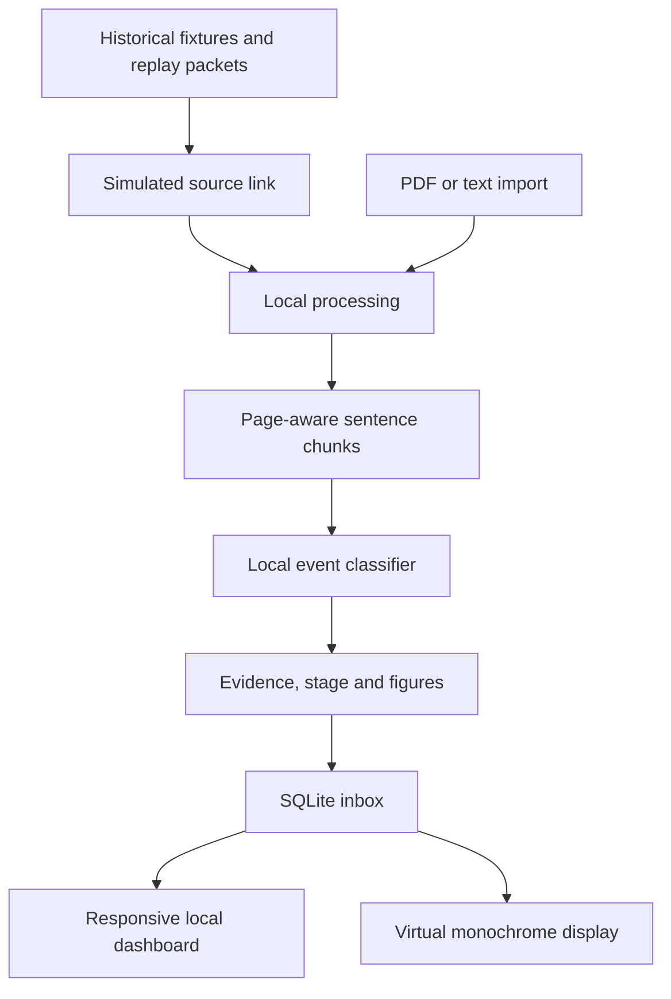

# StockBrief Edge

## Problem statement

Indian stock-market participants need to identify and verify important company disclosures across an NSE watchlist, including when connectivity is intermittent. How can an offline-capable financial NLP system turn long or repetitive disclosures into traceable event briefs on a modest CPU?

**Primary user** A retail watchlist researcher or student analyst. The main job is triaging disclosure text before reading the full source. A typical question is “Did Infosys sign an acquisition agreement or has the deal actually closed?”

**Product boundary** Event classification and supporting evidence. The application has no price forecast, trading signal, broker integration, or legal determination of materiality. “Review” means the system found weak, ambiguous, or unresolved evidence.

## Research and decisions

- The [NSE corporate announcements portal](https://www.nseindia.in/companies-listing/corporate-filings-announcements) lists issuer, subject, broadcast time, and attachments. NSE’s [filing guidance](https://nsearchives.nseindia.com/web/sites/default/files/inline-files/Guidance%20on%20filing%20Announcements%20on%20NSE%20Electronic%20Application%20Processing%20System%20%28NEAPS%29%20platform%20pursuant%20to%20the%20SEBI%20%28Listing%20Obligation%20and%20Disclosure%20Requirement%29%20%28Second%20Amendment%29%20Regulati_0.pdf) distinguishes event occurrence from submission. Preserve source dates as supplied and keep simulated arrival order separate.
- [Infosys’ acquisition announcement](https://www.infosys.com/newsroom/press-releases/2024/infosys-acquire-in-tech.html) describes an agreement. [Tata Motors’ demerger announcement](https://www.tatamotors.com/press-releases/demerger-of-cv-business-undertaking-of-tata-motors-ltd-into-a-separate-listed-company/) explicitly names outstanding approvals. This difference is more useful for verification than generic positive or negative sentiment.
- [FinBERT](https://github.com/ProsusAI/finBERT) addresses financial sentiment. StockBrief’s task uses a different label space: earnings, corporate action, deal, governance, regulatory, operations, routine, and review.
- The edge default learns word and character TF-IDF features from original labeled examples using regularized logistic regression. A keyword classifier is the comparison baseline. Sentence-level scoring preserves evidence locations. Conservative stage and amount extraction remain inspectable rules.
- The optional research comparator uses [quantized MobileBERT MNLI](https://huggingface.co/Xenova/mobilebert-uncased-mnli) for zero-shot event classification. For each candidate event, an entailment hypothesis is paired with the same source chunk. Scores are ranking signals. Local artifacts are loaded explicitly and inference makes no network request.

## User experience

- **Inbox** shows local disclosures grouped by watchlist ticker, category, and review status. Open an event to see the strongest evidence, source page, status, figures, provenance, and original link when provided.
- **Analyze** accepts pasted text, TXT, and text-based PDFs. It returns a local result and stores the extracted text and brief. Scanned PDFs return a clear extraction error.
- **Edge lab** advances a scripted source replay. Set the link offline, advance through a new packet, inspect the pending count, and analyze a disclosure already on the device. Reconnect to deliver the queued records. A retransmission does not create a second brief.
- **Evaluation** reports the labeled suite, F1, abstention coverage, latency distribution, process memory, and CPU affinity if available. Optional transformer runs use the same held-out fixtures.

## System design

The Python HTTP app serves all assets from loopback. SQLite stores source text and derived briefs. Replay cursor, connectivity state, packet queue, and brief writes use transactions. A content fingerprint includes issuer, publisher, document date, and normalized page text where publisher identity is known. Unidentified user text is keyed by issuer and normalized text. Near-duplicate matching, OCR, multi-label classification, automatic entity linking, exchange polling, and device deployment are outside this version. Users explicitly select the primary ticker. A document containing more than one topic is represented by a dominant event and evidence, subject to the review threshold.

Simulation boundaries are explicit. The offline switch blocks only simulated inbound delivery. Local work continues and an outbound connection is unnecessary. Latency and memory describe the host process. A Linux CPU affinity option or a container can constrain local execution. A software-generated 128×64 image is a display simulation. Raspberry Pi performance, battery life, and electrical compatibility require physical measurements.

## Evaluation design

Use disjoint training, calibration, and test fixtures. Tune the selective prediction policy on calibration only. Report macro-F1, per-class scores, confusion matrix, coverage, selective accuracy, and p50/p95 inference latency. Count abstention as a miss when the document has a known event category. For ambiguous documents, test that they reach review on a separate labeled slice. Historical source-backed examples verify the workflow independently of model fitting and should be reported as a small case study. Fixtures written by one author are an engineering test and have limited external validity.

The first release is ready when a fresh setup runs without a cloud API key, cited evidence is an exact substring of the extracted page, a pending packet survives pause and restart, replay drains idempotently after reconnect, and the report distinguishes desktop measurements from simulated device behavior.
